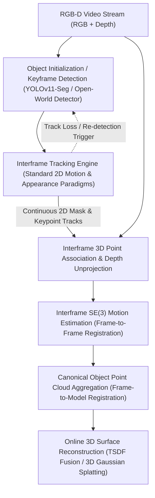

# Next-Gen 3D Object Detection, 6D Pose Tracking, and Point Cloud Reconstruction

**Authors:** Nicholas Nolen, Gan-Orgil Gantumur  
**Target Hardware:** Consumer-grade GPU (NVIDIA RTX Series)  

---

## 1. Background & Motivation

### Problem Importance
Real-time 3D object detection, pose estimation, and reconstruction from RGB-D sensors are fundamental challenges in computer vision and robotics. Practical applications include:
* **Robotic Vision & Manipulation:** Enabling autonomous agents to grasp and interact with unknown or unmodeled objects.
* **Autonomous Driving & Collision Detection:** Distinguishing moving entities from static background structures in real time.
* **Spatial Computing & 3D Video Telephony:** Real-time semantic parsing and mesh/point representation of dynamic indoor scenes.

### Limitations of Prior Work
* **CAD Model Dependence:** Traditional 6D pose estimators rely heavily on prior 3D CAD models of objects, making them brittle in open-world, model-free settings.
* **Heavy Latency & Compute:** Deep implicit neural representations (e.g., standard NeRFs / neural implicit surfaces) and iterative optimization frameworks developed between 2016–2020 often require multi-second compute per frame, preventing real-time deployment on consumer hardware.
* **Occlusion Failure:** Conventional tracking pipelines fail catastrophically when objects undergo complete occlusion or interact with hands and clutter, losing track permanently once line-of-sight is broken.

### Proposed Method (Summary)
We propose an end-to-end, real-time pipeline that couples **interframe tracking-by-detection** with 3D depth unprojection and canonical $SE(3)$ registration. Under this paradigm, once an object is detected in an initial frame, it is persistently tracked across subsequent frames using standard interframe motion and appearance paradigms (Kalman filtering, bipartite association, and video memory propagation). By linking 2D interframe tracks directly to unprojected 3D point compositions, the pipeline continuously discovers, tracks, and accumulates complete 3D object geometries over time on modern consumer hardware.

---

## 2. Methodology & System Architecture

### Key Components

#### 1. Interframe Object Detection & Tracking Paradigms
Rather than executing expensive, frame-independent detectors on every frame (which suffer from temporal jitter, flickering IDs, and redundant computation), the pipeline employs standard **interframe tracking paradigms**:
* **Initial Detection & Discovery:** In keyframes (e.g., frame $t_0$), an object detector/segmenter (YOLOv11-Seg or promptable foundation model) detects candidate objects and generates high-fidelity initial masks.
* **Standard Interframe 2D Tracking:** In subsequent frames ($t_1, t_2, \dots$), the detected object is propagated and followed through standard tracking mechanisms:
  * **Motion Prediction:** A linear or constant-velocity Kalman filter models bounding box/centroid dynamics to provide an interframe search window prior.
  * **Appearance & Feature Association:** Re-ID embeddings and spatial IoU are matched across consecutive frames using Hungarian/bipartite matching (as in ByteTrack and BoT-SORT) to preserve identity continuity.
  * **Dense Interframe Mask Propagation:** For pixel-accurate boundaries, video object segmentation (e.g., SAM 2's memory bank or Cutie) propagates masks temporally via space-time memory attention.
* **Drift Recovery & Re-Detection:** If interframe tracking confidence falls below a set threshold (or during heavy occlusions), the keyframe detector re-fires to verify identity and re-anchor the tracking state.

#### 2. Interframe 2D-to-3D Point Mapping & Object Collections
As an object is tracked in 2D across frames, its 3D point composition is extracted and assigned to a persistent object identity:
* **Unprojection:** Pixels $(u, v)$ within the tracked 2D boundary with valid depth $Z = D(u, v)$ are unprojected into 3D camera coordinates:
  $$\begin{bmatrix} X_c \\ Y_c \\ Z_c \end{bmatrix} = Z \cdot K^{-1} \begin{bmatrix} u \\ v \\ 1 \end{bmatrix}$$
* **Object Point Collection:** Every newly observed 3D point is directly assigned to the tracked object's collection, establishing an evolving multi-view composition of the entity.
* **Depth & Edge Filtering:** Bilateral filtering and statistical outlier removal (SOR) eliminate edge-bleeding "flying pixels" and disconnect background geometry.

#### 3. Interframe Motion Estimation & $SE(3)$ Registration
To aggregate points over time without spatial smearing, the pipeline decomposes object motion into interframe and canonical transformations:
1. **Interframe Relative Motion:** Matched 2D keypoint tracks (via CoTracker3/TAPIR) paired with depth yield direct 3D–3D correspondences between frame $t-1$ and frame $t$. The interframe relative motion $T_{t-1 \to t} \in \mathrm{SE}(3)$ is estimated using robust RANSAC + Kabsch/Umeyama.
2. **Canonical Frame-to-Model Registration:** Points are projected into the object's canonical coordinate system $M$:
   $$p_{\text{canonical}} = T_{\text{canonical} \leftarrow t} \cdot p_c^{(t)}$$
   Fine alignment is enforced with Point-to-Plane ICP against the existing accumulated model.

#### 4. Temporal Point Aggregation & Re-Observation
* **Surface Expansion:** As an object translates and rotates, previously hidden surfaces enter the field of view. Their 3D points are mapped to the object's coordinate frame and fused into the canonical collection.
* **Occlusion Recovery & Re-Identification:** If the interframe tracker loses an object due to full occlusion, the detector/re-ID module re-locates the object upon reappearance and associates the new observations with the stored canonical point cloud.

#### 5. Online 3D Reconstruction
* **TSDF Voxel Integration:** Incrementally integrate registered point clouds into a Truncated Signed Distance Function (TSDF) grid using Open3D / VoxelHashing to produce smooth watertight meshes.
* **Isolated Object 3D Gaussian Splatting (Optional Exploration):** Optimize per-object Gaussian ellipsoids initialized from the canonical points for photorealistic novel view synthesis and appearance modeling.

---

## 3. Experimental Validation

### Datasets
We evaluate on benchmark datasets matching the standard evaluation protocols in model-free 6D tracking and reconstruction:
* **HO3D (Hampali et al., CVPR 2020):** Challenging hand-object interaction sequences featuring severe occlusions and fast motion.
* **YCBInEOAT:** Robot end-effector manipulation sequences containing YCB objects with ground-truth poses.
* **YCBMultiTrack (Lin et al., ECCV 2024):** Complex multi-object tracking sequences featuring mutual occlusions and out-of-frame re-identifications.

### Baselines
* **Point2Pose (Lin et al., ECCV 2024):** State-of-the-art occlusion-recovering 6D pose tracking and 3D reconstruction using 2D point trackers.
* **BundleSDF (Wen et al., CVPR 2023):** Neural 6-DoF tracking and neural SDF reconstruction baseline.
* **se(3)-TrackNet (Wen et al., IROS 2020):** Classical RGB-D residual-based 6D tracking baseline.
* **2D Segmentation Baseline:** Compare tracking stability when initialized with **SAM 2** vs. **YOLOv11-Seg**.

### Evaluation Metrics
* **Pose Estimation Accuracy:**
  * **ADD-S (Average Distance of Model Points - Symmetric):** Area Under Curve (AUC) across thresholds from 0 to 10 cm.
  * **$< 2\,\text{cm}$ / $2^\circ$ Success Rate:** Strict precision metric for robotic grasp viability.
* **Reconstruction Quality:**
  * **Chamfer Distance (CD):** Distance between reconstructed point clouds/meshes and ground-truth CAD models.
  * **F-Score:** Precision and recall at specified distance thresholds (e.g., 5 mm).
* **System Efficiency:**
  * **Inference Latency & FPS:** Achieved throughput on a single consumer GPU (NVIDIA RTX 40/50 series).

---

## 4. Project Timeline

| Week | Milestone & Deliverables |
| :--- | :--- |
| **Week 1: Foundations & Ingestion Pipeline** | Set up RGB-D data pipelines for HO3D and YCBMultiTrack. Implement 2D mask extraction (YOLOv11-Seg / SAM 2) and camera unprojection to 3D. |
| **Week 2: Tracking & Registration Core** | Integrate 2D point tracker (CoTracker3) with 3D depth unprojection. Implement online $SE(3)$ pose solver (RANSAC + Point-to-Plane ICP) and canonical accumulation. |
| **Week 3: Occlusion Recovery & Reconstruction** | Implement visual feature re-identification for occlusion recovery. Integrate TSDF mesh reconstruction and benchmark against initial Point2Pose baselines. |
| **Week 4: Optimization & Comprehensive Evaluation** | Optimize GPU kernels for real-time throughput ($>30\text{ Hz}$). Conduct full quantitative evaluation on ADD-S, Chamfer Distance, and latency benchmarks. |
| **Week 5: Final Report & Code Release** | Package reproducible training and inference scripts; draft final paper report and generate demo videos. |

---

## 5. References

1. **Lin, Tzu-Yuan, et al.** *"Point2Pose: Occlusion-recovering 6D pose tracking and 3D reconstruction for multiple unknown objects via 2D point trackers."* European Conference on Computer Vision (ECCV), 2024.
2. **Wen, Bowen, et al.** *"BundleSDF: Neural 6-DoF tracking and 3D reconstruction of unknown objects."* IEEE/CVF Conference on Computer Vision and Pattern Recognition (CVPR), 2023.
3. **Wen, Bowen, et al.** *"se(3)-TrackNet: Data-driven 6D pose tracking by calibrating image residuals in synthetic domains."* IEEE/RSJ International Conference on Intelligent Robots and Systems (IROS), 2020.
4. **Hampali, Shreyas, et al.** *"Honnotate: A method for 3D annotation of hand and object poses."* IEEE/CVF Conference on Computer Vision and Pattern Recognition (CVPR), 2020.
5. **Ravi, Nikhila, et al.** *"SAM 2: Segment Anything in Images and Videos."* Meta AI Research, 2024.
6. **Karaev, Nikita, et al.** *"CoTracker3: Simulating Much More Data for Better Point Tracking."* arXiv:2410.11831, 2024.
